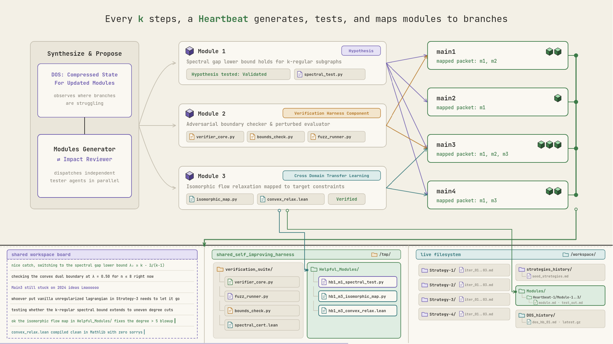
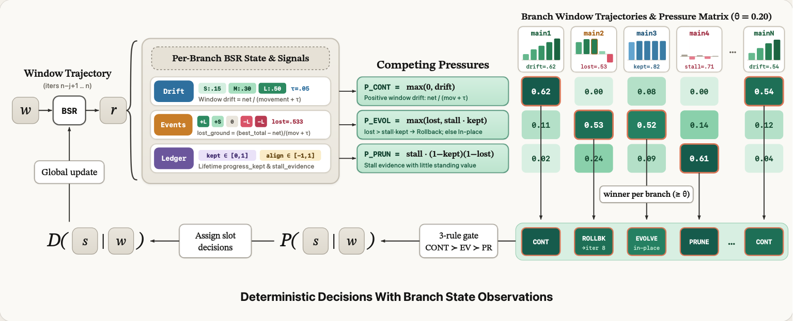
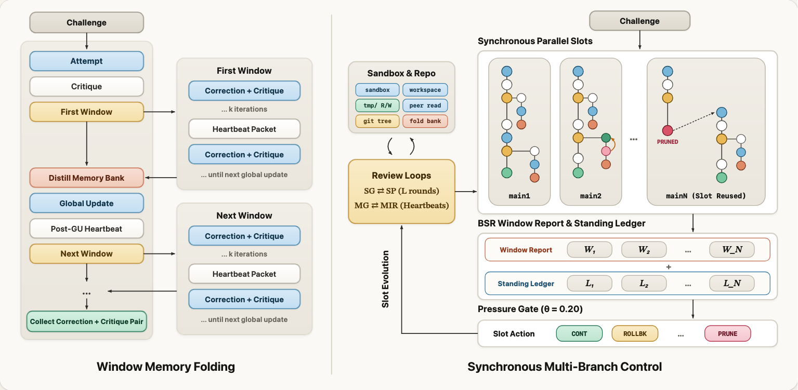
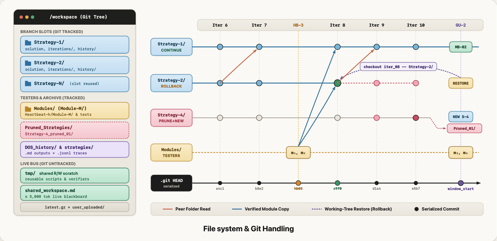

## Deepthink pipeline flow

Deepthink is a carefully thought multi-agent pipeline that coordinates agents with focused roles by routing precise, surgical context to explore the solution search space. More broadly, it explores diverse "correct trajectories", "implementations", or "executions" in parallel for any given user request. The system is based on the following ideas: "strategies proximity", "modules impact review", "parallel exploration", "iterative corrections/refinements", "cross-strategy-learning through curated context", "independent modules generation & testing", and a "meta strategies evolving loop". Each agent role can be steered surgically by the user as needed.

### Full Deepthink flow

You provide the problem or attach codebase files into the virtual environment and start the run. The system first generates high-level, distinct ways to approach the core challenge, which act as strategies. The system does not generate strategies in a single shot. A Strategy Generator and a Strategy Proximity Reviewer go back and forth for a few rounds so that surface-level variations, overlapping ideas, or blind spots get caught and refined before any execution starts.

In Iteration 1, every branch runs in parallel to produce its initial work inside its own `Strategy-N/` folder. Once all branches finish, a Critique agent runs on each branch in parallel to evaluate the solution for correctness, completeness, broken constraints, structural weaknesses, and whether the strategy itself still looks viable. The critique diagnoses issues without rewriting the solution.

From the second iteration onward, every branch runs a Correction agent followed by a Critique agent in parallel. The Correction agent receives the core challenge, its assigned strategy, the back-and-forth correction and critique history of its branch, any tested module packets routed to it, and the latest work and critiques from the other active branches so it can learn from what worked or failed across peer strategies. If you turn on `isolateBranches`, the Correction agent only sees its own branch. It produces an improved solution, which the Critique agent then evaluates again.

On top of this core loop, two periodic mechanisms keep the branches sharp and prevent wasted compute.

### Heartbeats: modules generation and testing

After every `k` iterations, a heartbeat runs to refresh the curated evidence fed into the branches. A heartbeat only runs if it will serve at least two corrections before the next global update, because every global update ends with its own heartbeat anyway.

First, a Dissected Observations Synthesis agent, or DOS, reads the latest work and critiques across all branches to summarize where every branch stands and how well earlier modules were actually used. For every module sent out in the previous heartbeat, DOS checks each target branch and classifies utilization as `USED_CORRECTLY`, `USED_PARTIALLY`, `NOT_USED`, or `MISUSED`. It also flags when a later critique gives strong evidence against a tester's verdict.

Next, a Modules Generator and a Modules Impact Reviewer go back and forth for `modulesImpactReviewLoops` rounds to propose `modulesCount` high-leverage modules about key uncertainties, bottlenecks, verification harnesses, or smaller cases worth verifying. When generating new modules, they also see the previous test verdicts, the utilization breakdown across branches, and whether branches actually benefited from them.

Dedicated tester agents then test each module independently in parallel inside `Modules/Heartbeat-h/Module-M/`. That way the branch execution agents do not have to spend their own tokens and attention testing side ideas. Each tester finishes with a verdict of `VALIDATED`, `REJECTED`, or `INCONCLUSIVE`, and can also drop reusable verification scripts or proven helpers into `/tmp` and `shared_workspace.md`. The runner maps the verified results back as focused information packets to the specific branches listed in `target_branches`, or to all branches when `target_branches` is empty.

In the iterations that follow a heartbeat, each branch's Correction agent receives its mapped module packet in `<LatestCustomCuratedContext>` and can pull verified scripts, proofs, and shared verifiers from `/tmp` and `/workspace` while coordinating live findings across branches on `shared_workspace.md`.

| Heartbeat synthesis, testing, and packet mapping | Branches pulling tested modules into subsequent iterations |
|---|---|
|  | .png>) |

### Global updates: branch evaluation, rollbacks, pruning, and memory distillation

After a window of `j` iterations, a global update runs to evaluate how each branch has been trending as a whole trajectory. No agent decides what happens to a branch. Instead, a Branch State Representation agent, or BSR, reviews the window for each branch and reports confirmed progress events, confirmed regressions, and how well corrections followed critiques.

BSR tags each confirmed event as `small`, `medium`, or `large`, which carry default weights of `0.15`, `0.30`, and `0.50`. A correction claiming it fixed a bug does not count as progress on its own. A later critique or a sandbox run has to back it up. BSR also outputs `critique_alignment` from `-1` to `1` so a good strategy does not take the blame when a correction agent ignored the critique.

Deterministic formulas in code combine that window report with the branch's lifetime standing event ledger. Code tracks the running total across the window, the peak iteration `last_good_iteration`, the share of movement undone after that peak as `lost_ground`, and the lifetime `progress_kept` ratio. Using the noise floor `bsrNoiseLevel` at `0.05` and pressure threshold `bsrPressureFloor` at `0.20`, code turns those signals into one of four outcomes:

- **Continue.** The branch is making real progress and keeps going.
- **Evolve in place.** The branch has built strong progress that is worth keeping, but its current angle has plateaued. The strategy generator updates its strategy to push further while keeping its work, history, and ledger intact.
- **Evolve with rollback.** The branch started well earlier in the window and then regressed into a worse trajectory. Rewriting a prompt rarely saves a branch that is already deep in a broken state, so the runner reverts the branch folder in git back to `last_good_iteration`, drops the discarded iterations from its history and ledger, and updates its strategy so it does not repeat the same dead end.
- **Prune.** The branch is stuck or failing with little standing progress. The runner archives its folder into `Pruned_Strategies/` and replaces the slot with a brand new strategy, which runs its first execution and critique before the next window begins.

At the same time, every surviving branch distills its window history into a compact memory bank covering what worked, what improved, and what critique patterns kept recurring, so future iterations stay focused without losing hard-won lessons.

After all `i` iterations complete, the runner sends the final solutions and critiques from the surviving branches to the Final Judge, which evaluates the candidates and selects the best execution.

| Deterministic BSR window scoring and slot decisions | Full multi-window memory folding and branch control loop |
|---|---|
|  |  |

### Git repository and shared workspace

When the sandbox environment is enabled, every agent works inside a shared git-backed repository at `Results/deepthink_<timestamp>/`, mounted at `/workspace` inside the sandbox.

Every branch folder, heartbeat test folder, and history file sits side by side in a single working tree. Because all branches run in parallel and read each other's files, everything has to be on disk at the same time.

Each branch writes inside its own `Strategy-N/` directory, which holds `strategy.md`, solution code, per-iteration markdown snapshots in `iterations/`, and raw `.jsonl` trajectories and memory banks in `history/`. Module testers work in their own `Modules/Heartbeat-h/Module-M/` directories. When a branch is pruned, the runner moves its folder to `Pruned_Strategies/Strategy-N_pruned_01/` so the `Strategy-N/` slot name stays clean for the replacement branch.

Every agent can read across the entire repository, use the untracked `/workspace/tmp` scratch directory for shared verification scripts and test runners, and read or update `shared_workspace.md` through the `shared_workspace` tool. That file is capped at 5,000 tokens and supports `read`, `edit`, and `append` actions so concurrent agents can leave verified notes for each other without waiting for the next iteration. Agents run their experiments with `sandbox_exec` and submit their final artifact through `final_output`, keeping raw command logs and failed experiments out of downstream prompts.

Agents never run `git commit` or `git checkout` themselves. The runner serializes all git commits between agent turns when nothing is writing, committing each `Strategy-N/` directory at the end of every iteration and at the start of every window. Restoring one rolled-back branch folder from an earlier commit never touches the other branches. The runner also writes a compressed state checkpoint to `latest.gz` after every step so you can stop and resume a run without losing finished work.



## Adaptive Deepthink

Adaptive Deepthink is basically deepthink mode access given to an orchestrator agent. It is still very brittle and I haven't really spent time observing its failures.

A central orchestrator running inside a LangGraph state loop decides at each pass when to generate or replace strategies with `generate_strategies`, when to formulate and independently test modules from critiques with `generate_modules` and `test_modules`, which branches to execute, critique, and correct in parallel with `execute`, and which promising branches to save permanently with `save`. Before a correction agent runs on an unsaved branch, the system takes a git snapshot of that branch directory. If the orchestrator decides not to save the branch after seeing the correction, the directory rolls back to that pre-correction snapshot before the next pass.

Long reasoning runs fall apart when the orchestrator's context fills up with old transcripts. To prevent that, the orchestrator calls `finalize_pass_and_execute` when a pass finishes. That writes the completed pass outputs into markdown files under `/workspace/Results` and moves a compaction boundary forward in the orchestrator's message history. Verbose transcripts from earlier passes drop out of the prompt and get replaced by file links that the orchestrator can read on demand with `read_files`. The orchestrator also has root read and write access to `/workspace` through `virtual_environment` and submits the final answer directly through `submit_final_output`.

---

## Installation and setup

Clone the repository, install dependencies, and start the dev server:

```bash
git clone https://github.com/ryoiki-tokuiten/Deepthink
cd Deepthink
npm install
npm run dev
```

The app starts at `http://localhost:3000/Iterative-Contextual-Refinements/`. You can configure all provider keys and models directly in the frontend UI, or optionally put `GEMINI_API_KEY`, `OPENAI_API_KEY`, and `ANTHROPIC_API_KEY` in a `.env` file in the project root.

## Sandbox execution environment configuration

When code execution is enabled, agents run bash commands inside an OS sandbox backed by Docker or bubblewrap, `bwrap`. By default, `ITERATIVE_STUDIO_SANDBOX_RUNTIME=auto` uses Docker when the Docker daemon is reachable and falls back to `bwrap`.

In Docker mode, containers run with a read-only root filesystem, all Linux capabilities dropped, `no-new-privileges`, and writable mounts only for the agent's assigned folder and `/tmp`. In bubblewrap mode, the backend creates isolated user, PID, IPC, and UTS namespaces, mounts system paths read-only, and restricts writes to the agent's folder and `/tmp`. If the host has a Rust toolchain, the backend mounts only the rustc sysroot read-only at `/sandbox-rust` so agents can run `rustc` and `cargo` without seeing your home directory.

A fresh clone does not silently download gigabytes of packages on startup. You can prewarm a shared read-only environment at `~/.cache/iterative-studio/sandbox-env`, mounted at `/sandbox-env` inside the sandbox, or adjust runtime limits and agent budgets at any time using environment variables when starting the server.

Configure the maximum tool calls per agent invocation, the wall-clock timeout per agent invocation, and the default and maximum timeout for each `sandbox_exec` command:

```bash
ITERATIVE_STUDIO_SANDBOX_MAX_TOOL_TURNS=64 \
ITERATIVE_STUDIO_SANDBOX_MAX_DURATION_MINUTES=60 \
ITERATIVE_STUDIO_SANDBOX_COMMAND_TIMEOUT_MS=120000 \
ITERATIVE_STUDIO_SANDBOX_MAX_COMMAND_TIMEOUT_MS=300000 \
npm run dev
```

Start with the full shared prewarm bundle, which installs the default scientific Python packages, Node utility packages, Lean 4 via `elan`, and a cached Mathlib Lake project:

```bash
ITERATIVE_STUDIO_SANDBOX_PREWARM=1 npm run dev
```

Prewarm Python and Node packages only, skipping the multi-gigabyte Lean 4 and Mathlib download:

```bash
ITERATIVE_STUDIO_SANDBOX_PREWARM=1 ITERATIVE_STUDIO_SANDBOX_LEAN=0 npm run dev
```

Enable Lean 4 and Mathlib prewarm on its own, and optionally pin a specific Lean toolchain or Mathlib revision:

```bash
ITERATIVE_STUDIO_SANDBOX_LEAN=1 \
ITERATIVE_STUDIO_SANDBOX_LEAN_TOOLCHAIN="leanprover/lean4:stable" \
ITERATIVE_STUDIO_SANDBOX_MATHLIB_REV="v4.31.0" \
npm run dev
```

When Lean and Mathlib are enabled, agents can run `lean-check` to verify the toolchain and `lean-init-mathlib ProjectName` to scaffold a workspace Lake project linked against the cached Mathlib build.

Override which Python or Node packages get preinstalled into `/sandbox-env`, or change where the shared cache lives on disk:

```bash
ITERATIVE_STUDIO_SANDBOX_PREWARM=1 \
ITERATIVE_STUDIO_SANDBOX_ENV_ROOT="$HOME/.cache/iterative-studio/sandbox-env" \
ITERATIVE_STUDIO_SANDBOX_PYTHON_PACKAGES="numpy scipy pandas matplotlib sympy networkx pytest hypothesis" \
ITERATIVE_STUDIO_SANDBOX_NODE_PACKAGES="lodash zod mathjs csv-parse fast-check" \
npm run dev
```

Force a specific sandbox runtime, disable network access inside the sandbox, or raise the Docker container CPU, memory, and process limits:

```bash
ITERATIVE_STUDIO_SANDBOX_RUNTIME=docker \
ITERATIVE_STUDIO_SANDBOX_IMAGE="python:3.12-bookworm" \
ITERATIVE_STUDIO_SANDBOX_NETWORK=none \
ITERATIVE_STUDIO_SANDBOX_CPUS=4 \
ITERATIVE_STUDIO_SANDBOX_MEMORY=4g \
ITERATIVE_STUDIO_SANDBOX_PIDS_LIMIT=512 \
npm run dev
```

Force bubblewrap with a private network namespace and a custom directory for storing Deepthink run repositories:

```bash
ITERATIVE_STUDIO_SANDBOX_RUNTIME=bwrap \
ITERATIVE_STUDIO_SANDBOX_NETWORK=none \
ITERATIVE_STUDIO_RESULTS_ROOT="./Results" \
npm run dev
```

## Supported providers and models

You can set up all providers and models directly from the frontend UI without touching config files, or pass API keys through environment variables. You can use one model for the entire run or assign different models from different providers to individual agent roles in the prompt settings:

- **Google Gemini.** Add your key in the frontend or set `GEMINI_API_KEY`.
- **OpenAI.** Add your key in the frontend or set `OPENAI_API_KEY`.
- **Anthropic.** Add your key in the frontend or set `ANTHROPIC_API_KEY`.
- **OpenAI-compatible endpoints.** Add any number of custom endpoints in the UI with a display name, base URL, optional API key, and model IDs. Works with OpenRouter, Together, Groq, Fireworks, DeepSeek, vLLM, LiteLLM, and custom gateways.
- **Local models through an endpoint URL.** Point the Local Models provider in the UI at a local server URL such as `http://localhost:11434` for Ollama, `http://localhost:1234` for LM Studio, or a local llama.cpp or vLLM server, and list the model IDs you want to use.


## External Harness Plugging Support

This is the part where I am kinda puzzled and have conflicting ideas:
one that the models are very good at certain harnesses because they have been trained inside them. and two as models get better and better over time most of the components, hand-holding and modules provided by that harness become redundant and are removed anw. I believe in keeping the most minimal harness that doesn't interfere with the agent's work as much. One more counter-point is that this system literally builds its own custom verification heuristics and harness on the fly because that's literally the point of some modules. So for now I am just keeping it to the agents. I might add a direct computer/browser use and academia search tools though.


See the full documentation for complete details:
- [Deepthink Architecture and Context Flow](Deepthink/docs/DeepthinkDocs.md)
- [Architecture Visuals](Deepthink/docs/deepthink_architecture.html)
- [Adaptive Deepthink Architecture](AdaptiveDeepthink/AdaptiveDeepthinkDocs.md)
- [Sandbox Tool Environment](Backend/README.md)

## License

Apache-2.0
